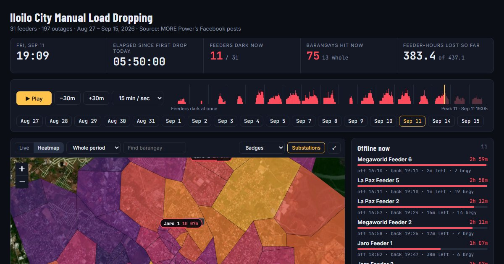

# Iloilo City Manual Load Dropping Map

Interactive replay of MORE Power's manual load dropping in Iloilo City, Aug 27 – Sep 15, 2026.

**Live map:** https://siuu3p.github.io/iloilo-load-dropping-map/

[](https://siuu3p.github.io/iloilo-load-dropping-map/)

- 197 outages across 31 feeders, from MORE Power's posts on its official Facebook page
- Satellite map with all 180 barangays shaded by which feeders serve them
- Live replay: feeders go dark on the clock, with elapsed time per feeder
- Heatmap: hours each barangay had a feeder dark, for the whole period or up to the playhead

Open `index.html` in a browser. It is a single self-contained file (about 2.7 MB, imagery and Leaflet included) and works offline except for web fonts.

Search for a barangay above the map. The URL hash keeps the time, feeder, barangay and view, so a copied link opens the same state.

## Layout

| Path | What it is |
|---|---|
| `index.html` | Built page. Do not edit by hand. |
| `feeder-coverage.json` | Barangays per feeder, substation sites, source and confidence for each. |
| `src/template2.html` | Page source: layout, styles, replay and heatmap code. |
| `src/events.json` | Outages as `[date, feeder, offline minute, online minute]`. |
| `src/geo.json` | Barangay boundaries plus feeder coverage and marker positions. |
| `src/base.webp` | Satellite base image with roads and labels (WebP, quality 75). |
| `src/leaflet.css`, `src/leaflet.js` | Leaflet 1.9.4 from cdnjs, inlined at build time. |
| `src/build.py` | Puts the pieces together into `index.html`. |
| `src/import_workbook.py` | Rebuilds `src/events.json` from the workbook's Combined Data tab. Standard library only. |

## Rebuild

```bash
python src/build.py
```

## Add new outages

Update the workbook's Combined Data tab, then:

```bash
python src/import_workbook.py "Manual Load Dropping in Iloilo City.xlsx"
python src/build.py
```

The importer rewrites `src/events.json`. When an offline time does not match the online time minus the duration, it trusts the online time and duration and prints the row. It also flags feeders missing from `src/geo.json`. The subtitle, date range and headline update on their own. The meta description, Open Graph text, `og.jpg` and the About notes do not, so edit those in `src/template2.html` by hand.

## Live volunteer feed (Google Sheet)

Volunteers can add outages without a rebuild. The page reads a published Google Sheet when it loads and merges it with the built-in data.

1. Make a Google Form with four questions: **Date**, **Feeder**, **Time off**, **Time on**. Use the Date and Time question types. Leave Time on blank while the outage is still going.
2. Link the form to a sheet. In the sheet, choose File > Share > Publish to web, pick the responses tab, choose CSV, and copy the link.
3. Paste the link into `const SHEET_CSV = "";` in `src/template2.html`, then run `python src/build.py`.

How rows are read:

- Columns are found by header name. Other columns, such as the form's Timestamp, are ignored.
- Dates can be `2026-09-16` or `9/16/2026` (month first). Times can be `15:21` or `3:21 PM`.
- Feeder names must match a feeder in `src/geo.json`, ignoring case. `Molo F3` is read as `Molo Feeder 3`.
- A row with the same date, feeder and time off as a built-in outage replaces it. Use this to fix an end time.
- A row with no Time on, dated today, shows as ongoing until the page loads again.
- Bad rows are skipped and logged in the browser console.
- If the sheet can't be reached, the page uses only the built-in data.

The page checks the sheet every 5 minutes. When it changes, a **New outage reports · Reload** button appears.

Anyone with the form link can submit, so share it only with trusted volunteers and check the responses. Deleting a row in the sheet removes it from the map.

## Languages

The page has an English / Hiligaynon toggle. Labels live in the `HIL` table in `src/template2.html`; the About section stays in English. The Hiligaynon text is a draft and needs a native speaker's check.

## Data sources and limits

- **Outage times:** MORE Power's manual load dropping posts on Facebook, compiled in a workbook. One fix: Molo Feeder 3 on Aug 27 is logged as 3:21 AM, but the day's tab and duration show 3:21 PM.
- **Feeder coverage:** MORE Power's feeder coverage graphics (Aug 2025, updated Apr 2026) for 24 feeders. Three feeders use older notices. Diversion F2, Megaworld F2, Mobile F4 and Mandurriao F3 have no published barangay list. Most lists name only part of a barangay, so shaded areas and heatmap hours are upper estimates.
- **Substations:** OpenStreetMap. Arevalo (So-oc) and the Mobile unit (placed at Mandurriao) are approximate.
- **Barangay boundaries:** PSA/NAMRIA, via faeldon/philippines-json-maps.
- **Imagery:** Sentinel-2 cloudless 2024 by EOX IT Services GmbH, from modified Copernicus Sentinel data, licensed CC BY-NC-SA 4.0 (non-commercial). Roads and place labels © Esri.

Because of the imagery license, this project is for non-commercial use.
